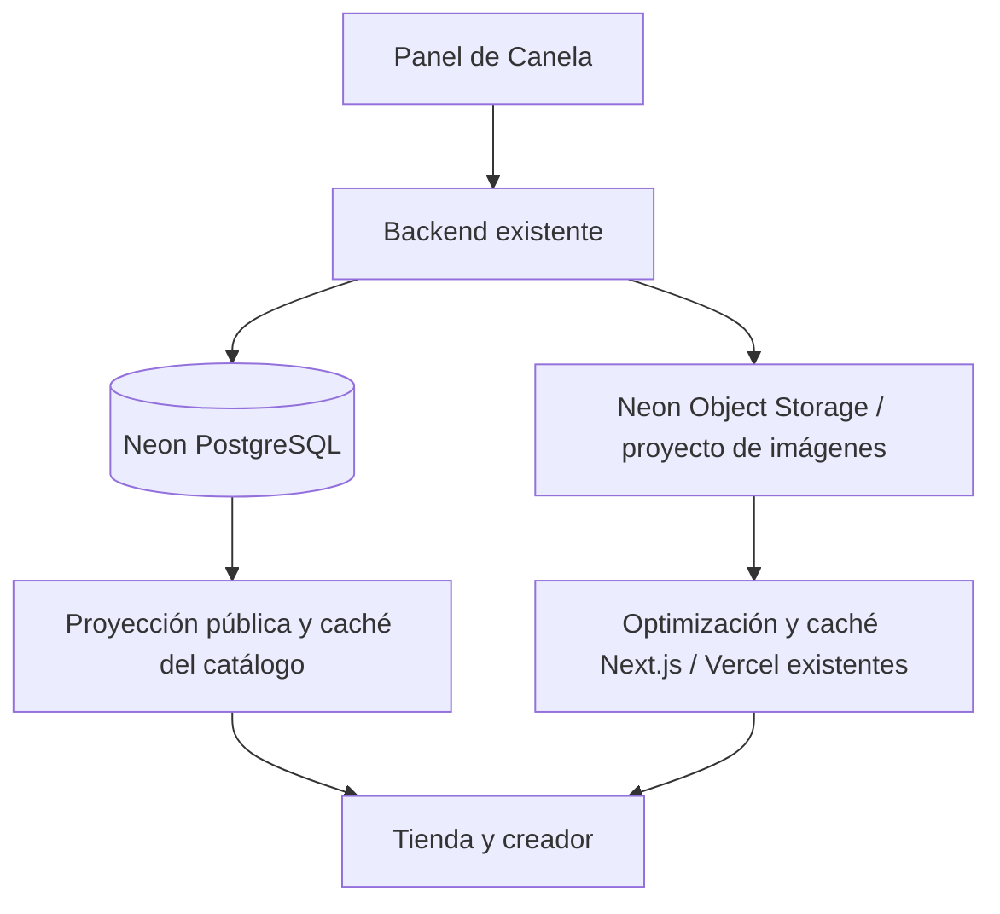

# ADR-007 — Decisión: catálogo y operación en el panel de Canela

**Estado:** Dirección aprobada por Bruno el 2026-10-28: panel y PostgreSQL,
con Neon Object Storage como proveedor de archivos. Implementación por etapas;
el cambio de autoridad y retiro de Sanity requieren los criterios de aceptación.
**Fecha:** 2026-10-28.
**Alcance original:** evaluación de la rama del creador y documentación oficial.
La implementación posterior se registra en CAT-154.

## Resultado de implementación — 29/10/2026

CAT-154 implementa el panel unificado, importación validada y stock transaccional.
PostgreSQL es la fuente seleccionada con `CATALOG_SOURCE=database`; archivos en
Neon Object Storage. Sanity conserva una copia de consulta con el Studio de solo
lectura. Se mantienen originales privados, variantes públicas optimizadas,
IDs/borradores/recortes y auditoría. La tienda continúa en mantenimiento.

Se importaron 35 fichas y 100 archivos; 27 productos y 3 slides publicados.
El respaldo de producción fue restaurado localmente. La aplicación y la guía
se verifican en [CAT-154](../evidence/CAT-154.md). La evaluación que sigue conserva
el contexto previo a la implementación; no describe una segunda fuente activa.

## Contexto y recomendación

Recomiendo llevar el catálogo, stock, cajas de envío, carrusel y catálogo de
cuadros al panel existente y a PostgreSQL. Los archivos deben almacenarse en
object storage; PostgreSQL conserva sus identificadores, relaciones y metadatos.

El motivo principal es adecuar la administración al negocio y reunir stock y
pedidos en una transacción local. El ahorro de una suscripción es secundario:
el uso actual de Sanity puede seguir siendo gratuito. Se asume el mantenimiento
del editor, de los archivos y de las políticas de recuperación.

La separación actual tiene autoridad por dominio; no hay dos saldos de stock
editables que se sincronicen. La limitación del dataset privado hizo visible una
separación que ya existía entre catálogo/inventario y pedidos/pagos. Migrar
reemplazaría ADR-006 y la spec 100 cuando se apruebe e implemente.

## Estado comprobado en el repositorio

| Área | Autoridad actual |
| --- | --- |
| Productos, precios, categorías, fotos y orden | Sanity `producto` |
| Stock, reservas y ajustes | Documentos operativos Sanity separados del producto |
| Embalaje individual y cajas | Sanity `shippingProfile` / `shippingBox` |
| Carrusel del catálogo | Sanity `heroSlide` |
| Diseños públicos autorizados | Sanity `frameDesign` |
| Pedidos, pagos, entregas, notificaciones, sesiones | PostgreSQL |
| Configuración privada y fabricación de cuadros | PostgreSQL |

Fuentes locales principales:

- `src/sanity/schema.ts`, `src/sanity/frame-schema.ts`.
- `src/modules/inventory/infrastructure/sanity-inventory.ts`.
- `src/db/create-reserved-order.ts` y `src/modules/payments/infrastructure/postgres/payment-confirmation-repository.ts`.
- `src/modules/customization/infrastructure/frame-catalog.ts`, `gallery-publisher.ts`
  y `postgres/workshop-repository.ts`.

Ya existen autenticación administrativa, componentes, validadores de stock,
auditoría, pruebas de concurrencia, configuración con borrador/publicación y una
interfaz de stock reutilizable. `/admin/inventario` hoy redirige a Studio.
Las tablas SQL antiguas de inventario están retiradas: no constituyen el saldo
actual y no deben reactivarse sin una importación y conciliación nuevas.

La dependencia de Sanity alcanza también las URLs y tipos de imágenes del
frontend, JSON-LD, portada, cotización, checkout y exportación a galería. Hay una
URL de la pieza de ajedrez escrita directamente en `home-destinations.tsx`.

## Volumen observado

Consulta del dataset `production`, proyecto Canela, 2026-10-28:

| Dato | Medición |
| --- | ---: |
| Productos publicados | 27 |
| Borradores de productos, leídos con autenticación | 7 |
| Carrusel | 3 documentos |
| Cajas / diseños públicos de cuadros | 0 / 0 |
| Archivos de imagen | 100 |
| Tamaño de originales según metadatos | 281.417.444 bytes, 281,42 MB |
| Referenciados por productos publicados y carrusel | 74, 214,53 MB |
| Imagen más grande | 20,38 MB |
| Referencias de productos con crop/hotspot | 8 |
| JSON de los 27 productos publicados | 24.269 bytes, sin binarios |

Los 26 archivos fuera de esa selección **no se consideran huérfanos**: falta
comprobar borradores, referencias desde código y otros usos antes de borrar.
Los 7 borradores no implican necesariamente 7 productos adicionales.

La conexión de `.env.local` midió 8.617.984 bytes y usa un esquema antiguo; esa
cifra no representa producción. La consulta SQL de tamaño de producción no pudo
completarse con la conexión obtenida por el CLI.

En la revisión posterior de la consola Neon, el 2026-10-28, se comprobó:

- Proyecto `canela-store` (`hidden-fire-41495098`), plan **Free**, región
  **AWS South America East 1 (São Paulo)**, 5 branches.
- Branch predeterminada `production` (`br-lingering-fog-achpwnmv`).
- El panel Usage muestra 32,38 MB de almacenamiento, 2,11 CU-horas,
  346,02 kB de historial y 858,22 kB de transferencia desde el 30 de septiembre.
  Son métricas de consola, sujetas a demora, no una medición SQL del tamaño ni
  una predicción del tráfico cuando la tienda esté abierta.
- El proyecto no muestra Object Storage entre sus servicios. Coincide con la
  lista oficial de regiones compatibles, que no incluye São Paulo.

## Opciones

| Alternativa | Desarrollo inicial | Operación de Mariela | Complejidad transaccional | Mantenimiento propio |
| --- | --- | --- | --- | --- |
| Mantener Sanity + panel | Bajo | Dos interfaces | Coordinación entre bases | Menor para contenido |
| Construir editor del panel sobre Sanity | Medio | Una interfaz | Conserva coordinación entre bases | Editor propio y Sanity |
| Sanity Growth | Bajo para privacidad | Dos interfaces salvo desarrollo adicional | Conserva coordinación | Similar al actual |
| Panel + PostgreSQL + archivos externos | Medio/alto | Una interfaz | Stock/pedido pueden ser atómicos | Mayor en edición y archivos |

El editor sobre Sanity es viable si solo se quiere unificar navegación. Para
Canela invertiría ese trabajo en la cuarta opción. Sanity permite personalizar
Studio; no es correcto atribuirle una imposibilidad general de personalización.

Sanity Free publica 2 datasets públicos, 10.000 documentos y 100 GB de assets.
Growth habilita datasets privados y cuesta USD 15 por asiento/mes. La privacidad
es una restricción real; el tamaño de las fotos actuales no es el problema.
[Precios y funciones oficiales](https://www.sanity.io/pricing).

## Diseño propuesto

- PostgreSQL: productos publicados/borradores, stock y movimientos, cajas, slides,
  diseños de galería, relaciones de imágenes y configuración privada existente.
- Mantener IDs estables. Precios validados a dos decimales y convertidos a centavos en el checkout;
  pesos y medidas con unidades
  explícitas. Borradores y publicación no sobrescriben el stock operativo.
- Checkout: reserva de todas las piezas y pedido en la misma transacción.
  Confirmar pago, consumir stock y encolar avisos usa otra transacción coherente.
  Las llamadas a MP, Zipnova y Resend conservan idempotencia, fallos ambiguos y
  recuperación. La base única no vuelve atómicos a los proveedores externos.
- Los snapshots de compras son históricos e inmutables, aunque cambie el producto.
- Al guardar/publicar se invalida el caché público. El checkout siempre comprueba
  precio y disponibilidad actuales en servidor. Evitar consultas por cada visita
  cuando una proyección pública cacheada resulta suficiente.
- La UI reúne producto, fotos, stock y envío, con secciones claras. Incluye
  búsqueda, duplicación, orden, borrador, publicación, archivo recuperable, aviso
  de cambios sin guardar y conflictos entre ediciones. No construir un CMS general.

## Capacidad y costos

Neon actualizó su plan Free: 1 GB PostgreSQL/proyecto, 100 CU-horas/mes y 5 GB de
transferencia. Su object storage incluye 5 GB separados de PostgreSQL, pero la
transferencia se comparte entre productos. Al agotar cómputo o transferencia,
Free puede suspender el compute; exceder almacenamiento impide escrituras.
[Planes actuales](https://neon.com/docs/introduction/plans).

La base actual del catálogo aporta poco volumen. Ejemplo de presupuesto, no
medición: 1.000 productos a 20 KB = 20 MB antes de índices y versiones. El
crecimiento relevante será pedidos, snapshots de cuadros, cotizaciones y eventos.

En el código `custom_frame_quote` persiste el diseño/snapshot por cotización; no
encontré limpieza explícita del repositorio productivo. Definir retención de
cotizaciones vencidas sin pedido, sesiones y eventos temporales. Nunca eliminar
el historial de un pedido para liberar espacio. Esta política es necesaria con
cualquiera de las dos arquitecturas; no exige reintroducir un cron de pedidos.

También importa cómputo: un compute de 0,25 CU activo 720 horas consume 180
CU-horas. Caché, consultas agrupadas, índices, invalidación por cambios y ausencia
de polling evitan mantenerlo activo por tráfico innecesario. La viabilidad
gratuita depende de uso real, no solo de que entren las tablas.

### Opciones para imágenes

**Preferencia revisada por Bruno:** conservar proveedores y evitar cambios de
DNS/CDN. Se propone **Neon Object Storage**, en un proyecto de imágenes separado
en AWS N. Virginia, conservando la base de negocio actual en São Paulo.
Esto reúne proveedores, aunque no los recursos en un único proyecto.

- Object Storage admite Ohio, N. Virginia, Frankfurt y Singapore. El proyecto
  actual no puede utilizarlo en su región. La propuesta no requiere mover la
  base de pedidos a otra región.
- Free incluye 5 GB de archivos por proyecto, separados del espacio PostgreSQL.
  Los 281,42 MB actuales representan aproximadamente el 5,6% de esa capacidad,
  antes de variantes, archivos nuevos y cambios conservados en branches.
- La transferencia Free es 5 GB/mes por proyecto y se comparte entre sus
  productos. Separar las imágenes evita que sus descargas consuman la cuota de
  transferencia del proyecto que procesa pedidos. Agotar la cuota puede afectar
  disponibilidad; el espacio libre no garantiza servicio gratuito con cualquier
  tráfico.
- El acceso público tiene una URL HTTPS propia de Neon. Se usa como origen para
  `next/image` y la caché existente de Vercel. Cambiarán el adaptador de imágenes
  y `images.remotePatterns`; no requiere cambiar nameservers, registros de
  Spaceship, dominio de Canela ni contratar/configurar una CDN nueva.
- Conservar originales privados y una versión web pública de tamaño acotado por
  imagen. Dejar los tamaños responsivos a Next/Vercel, con URLs inmutables y
  caché prolongada. No servir originales de hasta 20,38 MB directamente a cada
  visitante ni generar todas las combinaciones de formato/calidad/tamaño.
- Neon no sustituye las transformaciones de Sanity. Se deben conservar crop,
  hotspot, transparencia y orientación en el nuevo proceso. La caché reduce
  lecturas al origen, pero mantiene sus propios límites/costos de Vercel.
- Lifecycle y versionado S3 se aceptan pero no se ejecutan: no depender de ellos
  para papelera, limpieza o recuperación. Aplicar claves inmutables, referencias
  y respaldo independiente según la política siguiente.

Fuentes: [Object Storage y regiones](https://neon.com/docs/storage/overview),
[planes y transferencia](https://neon.com/docs/introduction/plans),
[URLs y acceso público](https://neon.com/docs/storage/buckets),
[limitaciones S3](https://neon.com/docs/storage/s3-compatibility),
[caché de imágenes Vercel](https://vercel.com/docs/image-optimization/managing-image-optimization-costs).

**Avance MED-151:** se creó `canela-media` (`winter-water-63518843`), plan Free,
AWS N. Virginia, branch `production` (`br-small-dew-b7f190rq`). Object Storage
está disponible y el bucket `originals` está creado como privado. La consola
incluyó una base PostgreSQL vacía; la aplicación no se conectó a ella.

El backend de preparación y almacenamiento pasó 35 pruebas aisladas, TypeScript
y ESLint. Bruno autorizó el bucket público `web` y la credencial S3 local;
ambos quedaron configurados. El contrato remoto pasó carga/descarga por hash,
privacidad del original, caché/MIME públicos y reintento idempotente. No se migraron
archivos de Sanity ni cambió la autoridad de catálogo/stock. Detalle en
[spec 151](../specs/151-almacenamiento-imagenes.md) y
[evidencia MED-151](../evidence/MED-151.md).

Alternativas si esa comprobación falla: Vercel Blob, por compartir el hosting
actual, o reevaluar otros proveedores. R2 deja de ser la preferencia: la entrega
mediante su dominio público propio agrega una zona Cloudflare, que contradice
la prioridad actual. No guardar binarios/base64 dentro de las tablas PostgreSQL.

## Política de imágenes

- Original conservado una sola vez, clave inmutable y hash para deduplicar.
- Variantes de tamaño acotadas, WebP/AVIF donde corresponda; preservar alfa,
  orientación y gestión de color. Las medidas finales se validan visualmente.
- Mantener crop, punto focal, orden y portada. Las versiones públicas se obtienen
  de ese original; no recomprimir repetidamente una imagen ya comprimida.
- Validar archivos reales, tipo, dimensiones/píxeles y tamaño; probar fotos desde
  el celular de Mariela, incluido HEIC si lo usa. La carga tendrá progreso,
  reintento y recuperación ante respuesta perdida.
- Subida autorizada y finalización idempotente: solo publicar referencias a
  objetos verificados. Archivos temporales y huérfanos se identifican aparte.
- Al reemplazar o archivar un producto no borrar una imagen compartida. Papelera
  y eliminación definitiva con período de retención y revisión de referencias.
- Respaldo independiente de originales + export de DB/manifiesto. Ensayar una
  restauración de ambos; disponer de CDN o de redundancia no sustituye al backup.
- Las fotos originales del comprador continúan procesándose en su navegador.
  Se persiste el diseño necesario para fabricar el pedido; la galería pública
  requiere consentimiento y no publica datos personales ni referencias internas.

## Esfuerzo estimado

Estimación de ingeniería inicial para una persona familiarizada con el código,
incluyendo QA: aproximadamente **60–100 horas**. No es un compromiso de calendario
ni se deduce linealmente del tiempo de generación de código. Validar después de
desglosar la spec y probar el proveedor de archivos.

| Trabajo | Horas orientativas |
| --- | ---: |
| Modelo SQL, adaptadores y stock transaccional | 14–22 |
| Editor de catálogo, cajas, carrusel y galería | 16–24 |
| Carga, procesamiento, referencias y recuperación de imágenes | 12–20 |
| Importación, conciliación y ensayo de reversión | 6–12 |
| QA de flujos, responsive, despliegue protegido y guía | 12–22 |

La importación del volumen actual es pequeña; la mayor parte del esfuerzo está
en integridad y experiencia administrativa. Quedan fuera un CMS general,
colaboración simultánea avanzada, historial infinito y nuevas reglas comerciales.

## Plan de migración recomendado

1. Aprobar la decisión, redactar spec y actualizar el contrato de autoridad de
   stock. Confirmar uso/plan real de Neon y resolver almacenamiento de archivos.
2. Pruebas primero para última unidad concurrente, carrito atómico, pago duplicado,
   rechazo, pago tardío, publicación editorial, permisos y snapshots inmutables.
3. Implementar modelo y panel sobre una base aislada. Preservar contratos públicos
   para mantener el storefront y el creador sin rediseños innecesarios.
4. Exportar Sanity completo, incluidos borradores y binarios, y respaldar PostgreSQL.
   [La exportación oficial incluye documentos y archivos](https://www.sanity.io/docs/content-lake/exporting-data).
   Comprobar los avisos de exportación: puede finalizar aunque falte un binario.
5. Importación idempotente preservando IDs, relaciones, orden, crop/hotspot y
   estado editorial. Copiar archivos con manifiesto, tamaño y checksum verificados.
   Conciliar stock/reservas con pedidos; no recuperar saldos SQL retirados.
6. Comparar catálogos antiguo/nuevo, totales, fotos y disponibilidad. Probar carga
   móvil, publicación, archivo/recuperación, pago/envío con dobles y sandbox.
7. Mantener la tienda en mantenimiento; congelar edición en Sanity durante el
   corte final. Comprobar que no queden intentos pendientes y considerar webhooks
   tardíos. Realizar exportación diferencial final y activar una sola autoridad.
8. Mantener Sanity como respaldo temporal de solo lectura. Revertir a la versión
   anterior solo si no hubo nuevas escrituras; en otro caso conciliar primero.
9. Actualizar la guía PDF y probar el recorrido de Mariela. Retirar SDK, endpoints,
   tokens y dependencias de Sanity cuando el nuevo sistema esté aceptado. Borrado
   definitivo del proyecto/dataset requerirá una decisión posterior explícita.

## Consecuencias y criterio de decisión

Mejoran la operación diaria, las validaciones del negocio, la privacidad por
campo y la consistencia stock/pedido. Aumentan la responsabilidad sobre edición,
archivos, controles de acceso, backups y mantenimiento. Un fallo de nuestra app
afectará también la administración del catálogo; Sanity hoy ofrece una interfaz
independiente. Una base con más funciones concentra impacto y requiere pruebas.

Si la prioridad inmediata fuese abrir sin tocar la arquitectura, conservar el
sistema actual reduce riesgo de calendario. Con la tienda aún en mantenimiento,
27 productos y sin carga operativa consolidada, la migración es más conveniente
ahora que después de acumular ventas e historial. Recomiendo ejecutarla como una
iteración acotada, con el almacenamiento de fotos separado y aceptación verificable.
