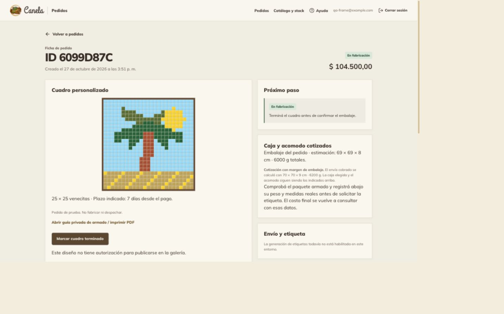
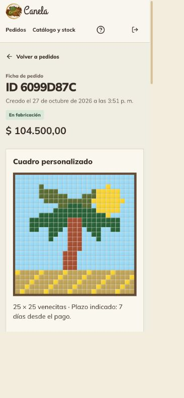
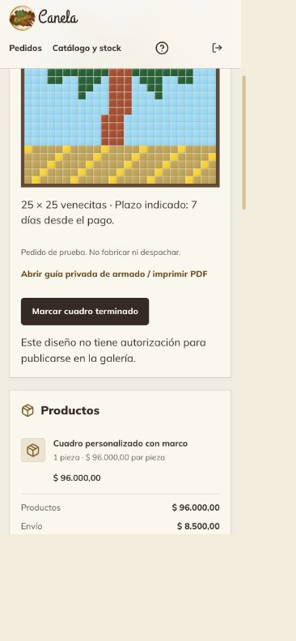
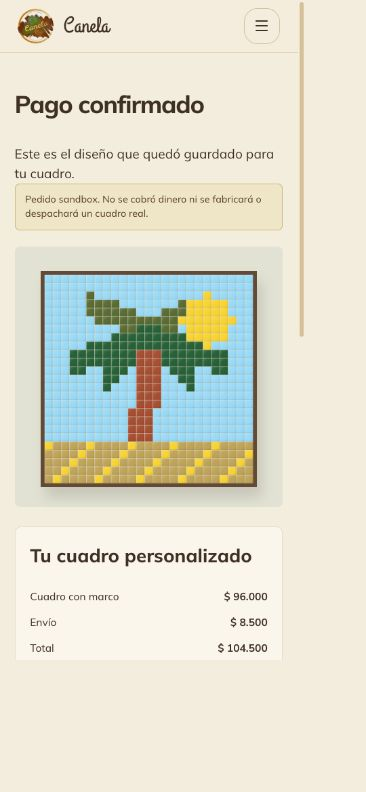
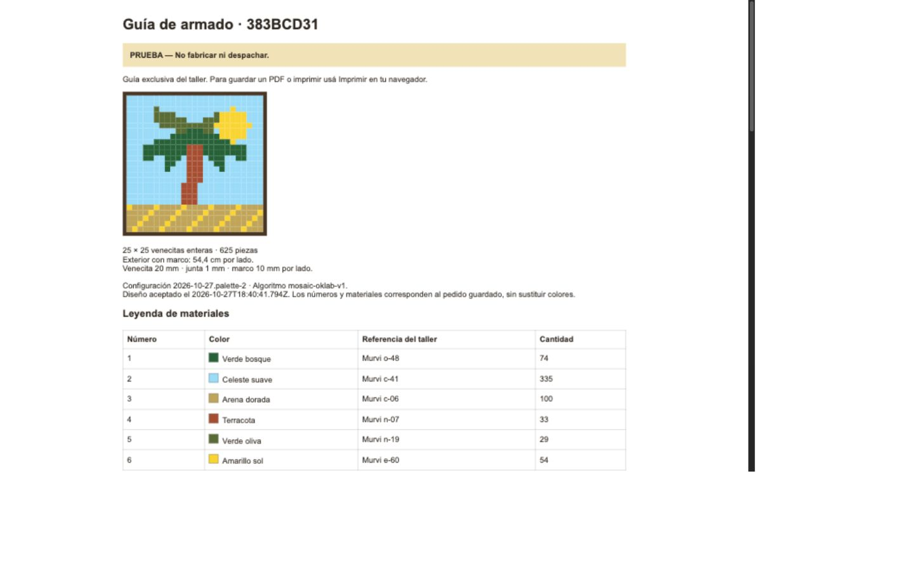

# PER-146 — Evidencia de operación persistente de cuadros

Fecha: 2026-10-27. Rama: `codex/creador-cuadros-personalizados`.
Alcance: [spec](../specs/146-cuadros-operacion-persistente.md).
Operación: [runbook](../runbooks/cuadros-personalizados.md).

## Resultado

Implementado el circuito durable en modo sandbox: cotización → cupo → pago
verificado → fabricación → guía → embalaje/envío, con galería editorial consentida.
Las ventas reales siguen bloqueadas. No se desplegó ni se alteraron datos de
Sanity, Mercado Pago, Zipnova o Resend reales.

## Ejecuciones

| Comprobación | Resultado |
| --- | --- |
| `pnpm test` | **817 pasan**, 83 omitidas por requerir servicios/DB explícitos; 102 archivos pasan |
| `TEST_DATABASE_URL=… pnpm test:db` | **74 pasan**, 12 archivos; PostgreSQL 17 local aislado |
| `pnpm exec tsc --noEmit` | Sin errores |
| `pnpm lint` | Sin errores |
| `pnpm build` | Build completo, incluidas rutas nuevas |
| `git diff --check` | Sin errores |
| Exportador del borrador de taller | NDJSON local válido, confirmaciones pendientes, no escribe remoto |
| Fixture para inspección del panel | Pedido y acceso administrativo locales; sin proveedores externos |

Los tests de base se ejecutaron de forma serial en una base descartable exclusiva
(port 55436). No usan `DATABASE_URL` de la tienda. Los cambios de recuperación del
editor posteriores a esa suite solo afectaron UI/aplicación, cubiertos por la
última suite general y build. La validación de proveedores usa dobles controlados;
no se ejecutó una compra nueva en las cuentas sandbox externas en esta iteración.

## Cobertura de criterios

| Criterio | Evidencia |
| --- | --- |
| CA-01 bloqueo real | `frame-commerce-http.test.ts`, matriz de flags; servicio requiere entorno test/sandbox |
| CA-02 validación/autorización del importe | `workshop.test.ts`, `sanity-workshop.test.ts`, integración de cotización/tarifa/vencimiento, body limitado |
| CA-03 persistencia/idempotencia/cupos | `frame-commerce.integration.test.ts`: reinicio de servicio, reintento, seis reservas concurrentes sobre cinco cupos, cotización de un solo uso |
| CA-04 pagos y stock | Aprobado/pendiente/rechazado/ambiguo, duplicados, respuesta tardía, revisión, outbox única, cero llamadas a inventario; `resume-frame.test.ts` conserva retoques para nueva cotización tras rechazo |
| CA-05 fabricación y permisos | Versión y orden de estados; anónimo/CSRF inválido denegados; guía solo pagados; preparación y claim de envío bloqueados hasta terminado |
| CA-06 diseño inmutable/guía | Trigger SQL rechaza cambios; guía de 45×45 con 2025 celdas y conteos exactos, escape HTML, coordenadas/leyenda por snapshot |
| CA-07 galería/privacidad | Consentimiento explícito, ambiente separado, error remoto recuperable, ID estable; copia sin PII/orden/materiales; parser público explícito |
| CA-08 compra/UI | `frame-sandbox-purchase.test.tsx`, `frame-result.test.tsx`, compra simulada previa, revisión visual 375px/1440px |
| CA-09 regresiones | Suite completa; 74 integraciones de checkout, stock, pagos, preparación, shipping, notificaciones y recuperación |

También se verifica que los datos del taller solo se lean de un dataset **privado**
separado. La tabla pública de precios coincide con el cálculo del servidor para
todos los tamaños permitidos, sin costos de materiales ni mano de obra.

## Revisión en navegador

Se utilizó una instancia local compilada en `localhost:3007`, con base aislada,
credenciales de proveedores vacías y generación de etiquetas/emails deshabilitada.
El puerto 3000 y las pestañas del usuario no se modificaron.

- Creador en 375px: revisión del diseño, formulario de envío, aceptación y
  autorización de galería desmarcada; sin desbordamiento horizontal.
- Panel en 1440px y 375px: diseño aceptado, guía privada, inicio de fabricación,
  transición a terminado y aparición de preparación. Guía abierta autenticada.
- Resultado móvil: mosaico persistido, importes finales, estado verificado y aviso
  sandbox. Se corrigió la superposición del carrito flotante; sus productos se
  conservan para la tienda. Ancho DOM 366px en viewport CSS 375px (sin overflow).
- Se agregó espaciado entre datos, guía y acciones de fabricación en la ficha.

### Capturas (todos los datos son ficticios)

## Límites pendientes de activación

La prueba de PDF de transporte usa contenido ficticio; no certifica una etiqueta
real. El HTML de fabricación se puede imprimir/guardar como PDF desde el navegador.
No se envió un email nuevo ni se escribió un documento en un dataset remoto.
Las APIs existentes se integran mediante sus adaptadores, pero el recorrido completo
con cuentas externas y el despliegue se repetirán en la activación controlada.

Mariela debe confirmar geometría, colores físicos/disponibilidad, precios finales,
paquetes reales, capacidad/plazos y condiciones. Estas confirmaciones no activan
ventas solas: la barrera de producción requiere una revisión expresa posterior.
